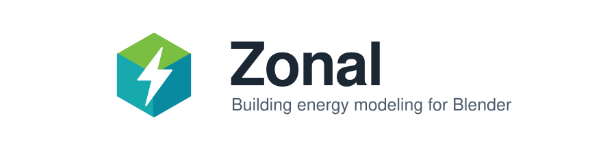

<p align="center">
  
</p>

<p align="center">
  <a href="https://bitenergie.github.io/zonal/">Documentation</a> ·
  <a href="https://github.com/bitenergie/zonal/releases/latest">Download</a> ·
  <a href="https://github.com/bitenergie/zonal/issues">Issues</a>
</p>

---

Zonal lets you build a building energy model in Blender and export it to [OpenStudio](https://openstudio.net). Draw or import the
geometry, assign spaces, zones, constructions and schedules, check the model visually, then export it for simulation with OpenStudio / EnergyPlus.
Existing OpenStudio models can be imported back into Blender to edit them.

## Features

- **Export** to OpenStudio `.osm`, `.gbxml`, `.sdd` and EnergyPlus `.idf`; **import** from the same formats.
- **Modeling tools:** draw surfaces, create spaces from a diagram or a mesh, match and intersect surfaces, shading and partitions.
- **Inspector** for buildings, spaces, zones, stories, space types, construction sets and schedules, with templates from `.osm` / `.idf` files.
- **Surface Search** and render modes (surface type, boundary condition, zone, story) to check a model visually.
- **Results:** load an EnergyPlus `.sql` file and show heat maps and labels, animated over time.
- **Scripts:** the OpenStudio user scripts of the SketchUp plug-in, ported to Python.
- glTF import / export is available separately (*File > Import / Export > OpenStudio glTF*).

## Requirements

- Blender 5.0 or newer
- Windows x64, Linux x64 / arm64 or macOS x64 / arm64

The OpenStudio 3.11 Python bindings are bundled with the extension (one zip per platform); nothing else needs to be installed.

## Installation

**From the extensions repository (recommended).** In Blender open *Preferences > Get Extensions > Repositories > + > Add Remote Repository*
and enter

```
https://github.com/bitenergie/zonal/releases/latest/download/index.json
```

then search for **Zonal** and install it.

**From a zip.** Download the zip for your platform from the [Releases](https://github.com/bitenergie/zonal/releases/latest) page and drag it into Blender.

See the [Get started](https://bitenergie.github.io/zonal/get-started/) guide for a first model.

## Documentation

Full documentation: **<https://bitenergie.github.io/zonal/>**, including the interface guide, a cheat sheet, the user scripts and the developer notes.

## Development

```
uv sync
uv run pytest -q
uv run ruff check .
uv run python scripts/build.py --install     # build the zip and install it into Blender
```

Architecture and conventions are described in [docs/dev/architecture.md](docs/dev/architecture.md).

### Releasing

Bump the version in `pyproject.toml`, `blender_manifest.toml` and `__init__.py` together (`tests/test_manifest.py` checks that they match),
then push a `vX.Y.Z` tag. [.github/workflows/release.yml](.github/workflows/release.yml) runs the tests, builds one zip per platform and attaches
the zips and `index.json` to the GitHub Release. GitHub Pages is used only for the documentation. To build the repository locally:

```bash
uv run python scripts/make_repo.py --base-url https://github.com/bitenergie/zonal/releases/download/vX.Y.Z
```

## License

GPL-3.0-or-later. Bundled third-party software (OpenStudio, BSD-3-Clause variant) is listed in [THIRD_PARTY_NOTICES.md](src/zonal/THIRD_PARTY_NOTICES.md).

## Disclaimer

Zonal is an independent project by Bitenergie. It is not affiliated with or endorsed by NREL, the Alliance for Sustainable Energy or the OpenStudio project.
OpenStudio is a trademark of its owners. Blender is a trademark of the Blender Foundation.
