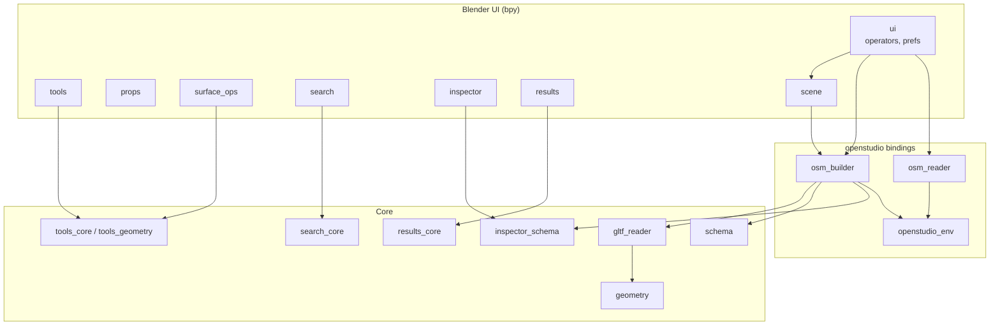
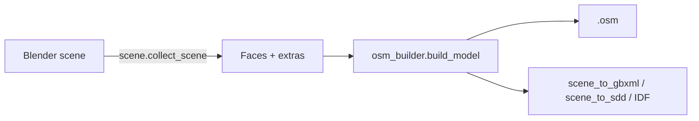
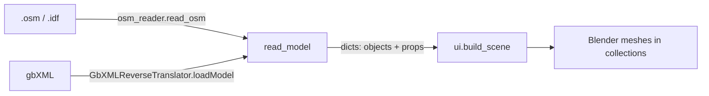

# Architecture

The add-on is the **inverse of OpenStudio's glTF forward translator**. OpenStudio turns a model into glTF with
`extras` (see `reference/openstudio_gltf/`, a copy of the C++ source and the `*.extras.schema.json` files); this add-on reads
the Blender scene with the same custom properties and rebuilds the model. That source is the specification for the property keys.
glTF itself is a standalone feature (operators `export_scene.openstudio_gltf` and `import_scene.openstudio_gltf`), not part of the `.osm` export.

## Two layers

The package `src/zonal/` is split so that everything worth testing runs without Blender:

| Layer | Modules | Imports |
| --- | --- | --- |
| **Core** (`core/`) | `geometry`, `gltf_reader`, `schema`, `tools_core`, `tools_geometry`, `search_core`, `results_core`, `inspector_schema`, `inspector_tree`, `schedule_rules`, `scripts_core`, `diagram_core`, `info_core`, `snap_core`, `epw`, `openstudio_env` | no `openstudio` at import time; numpy and, where faster, `mathutils` / `bpy` are allowed |
| **OpenStudio** (`core/`) | `osm_builder`, `osm_reader` | `openstudio` bindings, loaded lazily through `openstudio_env.load` |
| **Blender UI** (`blender/`) | `ui`, `scene`, `tools`, `props`, `surface_ops`, `search`, `inspector`, `results`, `scripts`, `modeling`, `schedule_ui`, `widgets`, `icons` | `bpy` |

`__init__` imports `blender.ui` lazily so the package stays importable in pytest. Keep logic that needs testing in the
pure modules; each Blender module is a thin layer over a `*_core` / `*_schema` partner.

## Export pipeline

Operator `EXPORT_SCENE_OT_openstudio_osm` in `blender/ui.py`:

1. **`scene.collect_scene`** reads the evaluated Blender meshes and their custom properties directly into `Face` objects (world-space planar polygons plus
   the `extras`); there is no glTF file. Objects of the collection `OpenStudio - Loose Geometry` are never exported. The operator merges the scene extras
   (`northAxis`, `modelObjectMetaData`, the Inspector store as `osmModel`, ...) and per-object defaults such as `spaceName` = collection name.
2. **`osm_builder.build_model`** creates the OpenStudio model from the scene and a `BuildOptions` (scale, default space name,
   template `.osm`, per-node `overrides`, optional `match_surfaces`). It returns the model plus a `BuildReport` (counts and warnings).
3. The model is saved as `.osm` (`scene_to_osm`), or translated to gbXML (`scene_to_gbxml`), SDD (`scene_to_sdd`) or IDF.

glTF is separate: `gltf_reader.read_gltf` parses a glTF file (Y-up files written by OpenStudio, generator `OpenStudio`, are converted automatically) and
`osm_builder.gltf_to_osm` / `gltf_to_gbxml` convert it without Blender. The Blender operators wrap Blender's own glTF exporter with extras.

### Repairs

Like the SketchUp plug-in, `osm_builder` repairs geometry and adds a `BuildReport` warning for every fix: `sanitize` (drop polygons with fewer than 3 vertices,
project out-of-plane vertices), `orient` (reverse upside-down Floor / RoofCeiling), `locate_parent` / `conform_to_parent` for sub surfaces, and `check_adjacency`
(every `Surface` boundary needs a partner pointing back).

### From triangles to surfaces (`geometry.py`)

Blender meshes are triangulated (`loop_triangles`, like glTF), while OpenStudio needs one polygon per surface. `faces_from_triangles`:

1. welds coincident vertices (`weld`),
2. clusters edge-connected, coplanar triangles (`cluster_coplanar`),
3. traces the outer boundary loops (`boundary_loops`) and keeps the one with the largest area (holes are dropped, because openings are separate sub surface nodes),
4. removes collinear points (`simplify`).

One Blender mesh with several faces therefore becomes several surfaces (`name 1`, `name 2`, ...), and the `surfaceType` extra is ignored for
base types on multi-face meshes (they are classified by tilt instead).

### Where the data comes from

Per-node data is read from the node `extras` using the OpenStudio schema keys listed in `schema.py` (`surfaceType`, `spaceName`,
`thermalZoneName`, `outsideBoundaryCondition`, ...). Priority, lowest to highest:

1. operator defaults,
2. mesh extras,
3. node (object) extras,
4. the Inspector **store** (`osmModel`), which wins over per-surface extras for the store-backed types.

Two kinds of data do not follow this order: the **space of a surface** and the **space attributes** have a single source of truth, see below.

### Spaces: one source of truth

A space has one story, one space type, one thermal zone and so on, so these values must never differ between the surfaces of a space. Per-surface copies were
hard to check and reset for users, so they are not stored per surface any more.

- **The space of a surface is its collection.** `surface_ops.space_collection(ob)` returns the first collection of the object that is neither the scene
  root nor `OpenStudio - Loose Geometry`; `surface_ops._space_of` is the resolver every module uses. Only the original collection counts: an object linked into
  several collections is a space member only through the first one (Blender does not record where an object was first linked, so this is the first match in
  its collection order). A `spaceName` custom property is ignored for surfaces. Space shading surfaces keep it, because for them it names the space the
  shading group belongs to, and objects outside any collection fall back to it.
- **Space attributes live on the Space.** `spaceTypeName`, `thermalZoneName`, `buildingStoryName`, `buildingUnitName` and `constructionSetName` are the
  fields `spaceType`, `thermalZone`, `buildingStory`, `buildingUnit` and `defaultConstructionSet` of the `Space` item in `Scene.osm_model`
  (`inspector.SPACE_ATTR_FIELD` maps the keys to the fields). `inspector.get_space_attr` / `set_space_attr` read and write them, and the `osm_<key>`
  proxies on `Object` use these helpers, so editing the value on any surface edits it for the whole space. The Properties editor says so. The tools that
  used to write per-surface values (Create Spaces From Diagram, Set Attributes for Selected Spaces, Set as Interior Partition, the library "New" and "Clear"
  buttons, `object.osm_set_prop`) write to the store or move the object to a collection instead.
- **Import** (`ui.build_scene`, shared by `.osm`, gbXML, IDF, SDD and glTF) puts these values on the space's store item (air loops on the zone's item),
  and creates the space collection; it does not write them on the surfaces. `osm_reader` now reads each zone's air loops.
- **Export** reads the store. Old scenes may still carry per-surface values, so `ui.default_space_overrides` uses them as a fallback only: it takes one value
  per space (the first non-empty one, objects sorted by name), forces it onto all surfaces of the space through the `!space` key of the overrides
  (`scene.object_faces` applies it after the object's own extras) and records a warning in `ui.SPACE_CONFLICTS` when the surfaces disagree. The same
  function forces `spaceName` = collection name, so a stale property cannot move a surface. The store still wins in the builder (`apply_store_spaces`).
  `airLoopHVACNames` is a property of the **thermal zone**, not of the space: OpenStudio's own glTF translator fills it from
  `thermalZone->airLoopHVACs()` (`GltfUserData.cpp`), and the builder calls `loop.addBranchForZone(zone)`. It is therefore the field `airLoops` (comma
  separated names) of the `ThermalZone` store item, applied by `osm_builder.attach_air_loops` in `apply_store_resources`. When the zone item has loops,
  the export forces them onto every surface of the zone and ignores per-surface leftovers; otherwise the legacy per-surface values are unified per zone
  (all spaces that end up in the same zone get one value, with a warning on conflicts, `ui.ZONE_ATTR_KEYS`). OpenStudio can connect a zone to only one
  air loop in practice, so expect a single name.
- **Migration.** The Inspector operator `scene.osm_migrate_spaces` ("Move Values to Spaces") moves per-surface values to the store item of the space (the
  first non-empty value wins, conflicts are reported; air loops go to the zone's item), deletes the keys from objects and meshes, and moves a surface whose `spaceName` differed from its
  collection into that space, so the effective space stays the same as before.
- **Standalone glTF export.** A glTF file has no collections, so `export_gltf_objects` temporarily writes `spaceName`, the space attributes and the zone's air loops onto
  the exported objects and restores them afterwards.

Readers that need a space value (render modes, Surface Search, the Results panel, the Inspector tree) call `_space_of` and `get_space_attr`; do not read
`ob["spaceName"]` or `ob["thermalZoneName"]` directly.

### Build order (`_Builder.run`)

The order matters:

1. scene metadata: stories, zones, space types, units, construction sets from `modelObjectMetaData`; Inspector store resources (`apply_store_resources`); weather file; `northAxis`,
2. **base surfaces** (Wall, Floor, RoofCeiling, ...), grouped into spaces,
3. **sub surfaces** (parent from `surfaceName`, otherwise by geometric containment),
4. **shading surfaces** and **interior partitions**,
5. store-backed space properties (`apply_store_spaces`), space transforms,
6. **adjacency**: the `Surface` boundary condition is resolved by name after all surfaces exist.

The boundary condition must be set before sun and wind exposure. `Space.transformation()` caches its first value, so it must not be called before
origin and relative north are set (`apply_space_transform`).

### Templates

`BuildOptions.template_osm` clones a template model and strips its spaces, zones, stories and so on, keeping space types, construction sets, constructions (with
materials and schedules). `templates/MinimalTemplate.osm` is the bundled default.

## Import pipeline

`osm_reader.read_model` turns an OpenStudio model into JSON-serialisable dicts (`kind` = surface / subsurface / shading / partition, a world-space
`polygon`, and `props` using the same keys as the export side, `schema.NODE_KEYS`). `ui.build_scene` creates one mesh per object inside a
collection per space. gbXML has no pipeline of its own: it goes through the OpenStudio model in both directions, so import and export share all of the code above. SDD works the same way (`scene_to_sdd`, `read_sdd`); OpenStudio 3.11's SDD reverse translator only reads result SDDs, not the "Input" SDD it writes.

## Modeling tools

| Feature | Blender side | Pure logic |
| --- | --- | --- |
| Draw Surface / Rectangle, Separate Faces, render modes, sidebar | `tools` | `tools_core` (`surface_type_from_normal`, `unique_name`, `scan_osm_names`), `tools_geometry` (snapping) |
| Surface Matching, Project Loose Geometry | `surface_ops` | `tools_geometry` (`match_surfaces`, `split_overlap`, `boolean_split_2d`, `project_polygon`) |
| Properties dropdowns, name library, `.osm` template | `props` | `tools_core.scan_osm_names` |
| Surface Search | `search` | `search_core` (`SearchCriteria`, `matches`, azimuth with north axis) |
| Inspector | `inspector` | `inspector_schema` (field table `TYPES`) |
| Results | `results` | `results_core` (`SqlResults`, `match_objects`, `value_range`) |
| Scripts | `scripts` | `scripts_core` (`UserScript`, `ScriptContext`, registry; scripts in `user_scripts/<group>/`) |
| Spaces & Groups, Info Tool | `modeling` | `diagram_core`, `info_core` |

Properties of surfaces are Object custom properties; the `osm_<key>` properties registered on `bpy.types.Object` are proxies that read and write them,
which gives dropdowns and search fields instead of free text. The exceptions are `spaceName` and the space attributes, which are proxies for the
collection and the Space store item (see [Spaces: one source of truth](#spaces-one-source-of-truth)).

### Inspector

Object-backed types (Surface, SubSurface, ShadingSurface, InteriorPartitionSurface) edit object custom properties through the proxies. Store-backed types
(Building, Space, ThermalZone, BuildingStory, BuildingUnit, SpaceType, WeatherFile, Default* sets) live in `Scene.osm_model`, are exported as the scene
extra `osmModel` (JSON) and applied by `osm_builder.apply_store_resources` / `apply_store_spaces` through the `FieldDef.setter` names.
To add a type or field, add one entry to `inspector_schema.TYPES`; a test checks that the setter exists in OpenStudio.

### Results

`results_core.SqlResults` wraps `openstudio.SqlFile`. `results` keyframes a float custom property `osm_result` on surfaces (key = object name) and zones
(key = `thermalZoneName`, or space / collection). A shared heatmap material reads it through an Attribute node. Labels are a Geometry Nodes group
`OSM_ValueLabel` with a keyframed Value input, so they animate and render without a handler. Geometry Nodes inputs are `mod.properties.inputs.<id>.value` and actions use the 5.x channelbag API (helpers `_set_input`, `_input_path`, `_fcurves`).

## OpenStudio bindings

`openstudio_env` finds `import openstudio` for Blender in one of two ways:

1. the wheel bundled in the extension zip (`wheels/`, built by `scripts/build.py`), or
2. an OpenStudio install whose Python matches Blender's CPython (preference `openstudio_path`; `<root>/Python` and `<root>/bin`).

The bindings always run in-process; there is no CLI subprocess backend. The wheel ABI must match Blender's Python: the add-on supports Blender 5.0+ only (CPython 3.13, the same as the dev `.venv`). A mismatch fails with "DLL load failed".

## Repository layout

| Path | Content |
| --- | --- |
| `src/zonal/` | the add-on (see above), `blender_manifest.toml`, `templates/`, `icons/`, `wheels/` (git-ignored) |
| `tests/test_*.py` | pytest unit tests, no Blender needed |
| `tests/blender_*_smoke.py` | headless end-to-end checks run with `blender -b --factory-startup --python ...` |
| `scripts/` | `build.py` (extension zip), `fetch_wheels.py`, `make_icons.py`, `docs_screenshots.py`, `serve_repo.py` / `make_repo.py` (extension repository), `dev_reload.py` |
| `docs/` | this site (Zensical) |
| `reference/` | local-only reference material (OpenStudio sources, SketchUp plugin), git-ignored |
