# Get started

Build, check and export a two-room model in about 20 minutes. This page assumes you have **never opened Blender**:
if you come from SketchUp, read [Blender in five minutes](#blender-in-five-minutes) first, then follow the ten steps.

<video class="osm-video" autoplay loop muted playsinline controls preload="metadata" src="../img/walkthrough.mp4"></video>

## Before you begin

- **Blender 5.0 or newer** (free, [blender.org](https://www.blender.org/download/)). The extension bundles the OpenStudio bindings.
- **Install Zonal**: *Edit > Preferences > Get Extensions > Repositories > + > Add Remote Repository*, paste
  `https://github.com/bitenergie/zonal/releases/latest/download/index.json`, then search for **Zonal** and click **Install**.
  Or drag the `zonal-<version>.zip` from the [Releases](https://github.com/bitenergie/zonal/releases) page into the Blender window.
  See [Dev > Setup](dev/setup.md) to build the zip yourself.
- **A mouse with a middle button** makes navigation easy. On a laptop, enable *Edit > Preferences > Input > Emulate 3 Button Mouse*
  (then ++alt+lmb++ replaces the middle button).

## Blender in five minutes

### The window

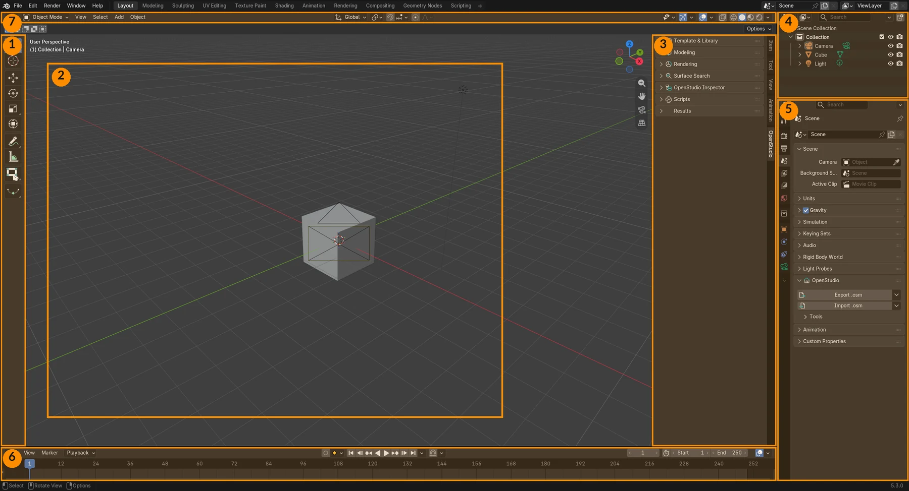

1. **Toolbar**: the tools (Select, Move, Rotate, ...). Zonal adds the **Draw Rectangle Tool**.
2. **3D viewport**: where you model. Shortcut keys act on the area *under the mouse pointer*.
3. **Sidebar**: press ++n++ with the pointer over the viewport. Its tabs are *Item* (position and size of the selected object)
   and **OpenStudio**, which holds every Zonal panel.
4. **Outliner**: the model tree, like SketchUp's Outliner. A **collection** is a folder of objects, and in Zonal a collection is a **space**.
5. **Properties editor**: scene, object and render settings. Zonal's **Export .osm** button is in *Scene > OpenStudio*.
6. **Timeline**: animation, ignore it.
7. **Header and tool settings**: menus and the options of the active tool.

### Moving around

| What you want | SketchUp | Blender |
| --- | --- | --- |
| Orbit | middle mouse | ++mmb++ drag |
| Pan | ++shift+mmb++ | ++shift+mmb++ drag |
| Zoom | wheel | mouse wheel |
| Zoom to the whole model | Zoom Extents | ++home++ |
| Zoom to the selection | Zoom Selection | ++numpad-period++ |
| Standard views | Standard Views | ++numpad-1++ front, ++numpad-3++ right, ++numpad-7++ top |
| Perspective / parallel | Camera menu | ++numpad-5++ |

### Doing things

| What you want | SketchUp | Blender |
| --- | --- | --- |
| Select | Select tool (++space++) | ++lmb++ click; ++shift+lmb++ adds; ++a++ all; ++alt+a++ none |
| Move / Rotate / Scale | ++m++ / ++q++ / ++s++ | ++g++ / ++r++ / ++s++, then type a number and press ++enter++ |
| Lock to an axis | arrow keys | after ++g++ press ++x++, ++y++ or ++z++ |
| Exact size | type in the Measurements box | **N > Item > Dimensions** |
| Rectangle tool | Rectangle (++r++) | **Draw Rectangle Tool** in the toolbar |
| Push / Pull | Push/Pull | none: add a box, or select a face in Edit Mode and press ++e++ (extrude) |
| Group / Component | Group, Component | **Object**. Every OpenStudio surface is one object |
| Tags (layers) | Tags | **Collections**. A collection is a space |
| Entity Info | Entity Info | **Sidebar > OpenStudio > Properties** |
| Hide / unhide | Hide, Unhide All | ++h++ / ++alt+h++ |
| Delete | ++delete++ | ++x++ or ++delete++ |
| Undo | ++ctrl+z++ | ++ctrl+z++ (redo ++ctrl+shift+z++) |

### Four habits that differ from SketchUp

- **Select first, then act.** Press ++g++, move the mouse (or type `2`), confirm with ++lmb++ or ++enter++. ++esc++ or ++rmb++ cancels.
- **Selected is not active.** Several objects can be selected, but only the one you clicked last is *active*, and the OpenStudio panels edit
  the active one. Hold ++alt++ while editing a value to apply it to all selected objects.
- **Stay in Object Mode.** ++tab++ switches to Edit Mode (editing vertices and faces). Zonal works on whole objects, so you rarely need it.
- **One surface = one object.** SketchUp faces live inside a group. Here each wall, floor and roof is its own object; the
  **Separate Faces** button does that for you (step 5).

More shortcuts are in the [cheat sheet](cheat-sheet.md).

## Step by step

### 1. Start a clean scene and open the OpenStudio tab

1. Start Blender and pick **General** on the splash screen (or *File > New > General*).
2. In the Outliner, right-click the collection **Collection** and choose **Delete Hierarchy**. This removes the default cube, light and camera.
3. Move the pointer over the viewport and press ++n++. Click the **OpenStudio** tab on the right edge of the sidebar.

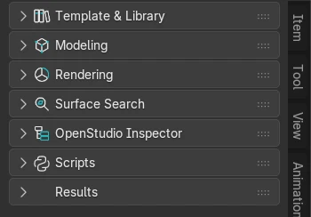{ width="350" }

### 2. Load the template

Open **Template & Library** and click **Default** next to *Template*. This fills the name library with space types, construction sets and
constructions that you pick from later. Set **Kind** to *Construction Sets* to see them.

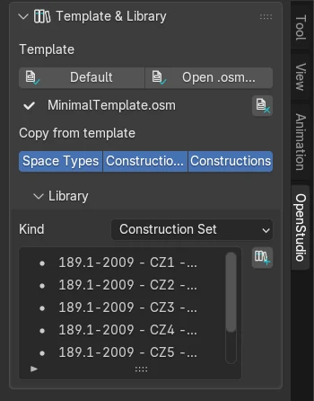{ width="350" }

### 3. Create a space

A space is a **collection**. In the Outliner right-click an empty spot and choose **New Collection**, double-click it, rename it to `Office`, and
click it once so it is highlighted (the *active* collection). Everything you add now goes into `Office` and gets `spaceName = Office`.

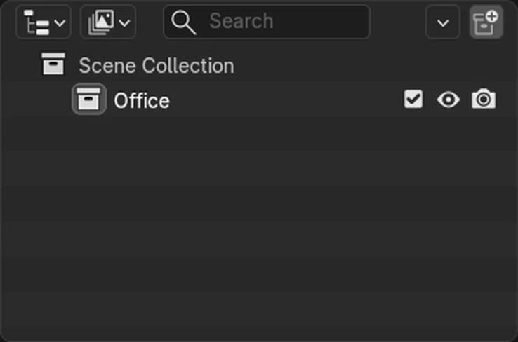

### 4. Model the room

=== "Add a box (recommended for the first model)"

    1. Hover the viewport, press ++shift+a++ and choose **Mesh > Cube**.
    2. Open the **Item** tab of the sidebar. Type `5`, `4`, `3` in **Dimensions** X, Y, Z (++tab++ jumps to the next field) and `1.5` in **Location Z**.
       The cube is centred on its origin, so this puts the floor at `Z = 0`.

    

    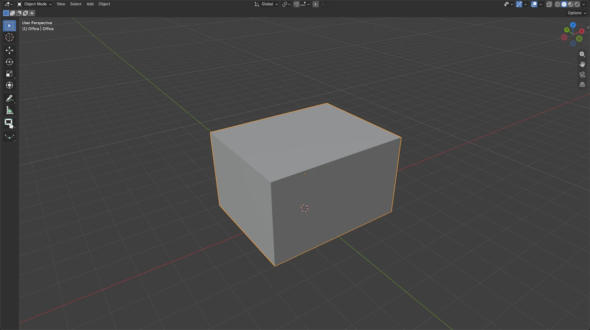
    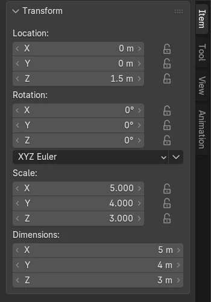{ width="350" }
    

=== "Draw it, like in SketchUp"

    1. Pick the **Draw Rectangle Tool** in the toolbar. Its options appear in the tool settings bar.
    2. **Untick Clone to Loose Geometry and Auto Boundary.** They are on by default because the tool is meant for windows (step 6);
       with them on, the rectangle becomes a drawing aid instead of a surface.
    3. Click two opposite corners for the floor. Points snap to vertices, edge midpoints and edges; hold ++ctrl++ to snap to a grid
       (**Snap Increment**). Set **Fixed Width** and **Fixed Height** to place a rectangle of exact size with one click.
    4. Repeat for the walls and the roof, snapping to the vertices that already exist, then continue with step 6 (each rectangle is already one surface, you can skip step 5).

    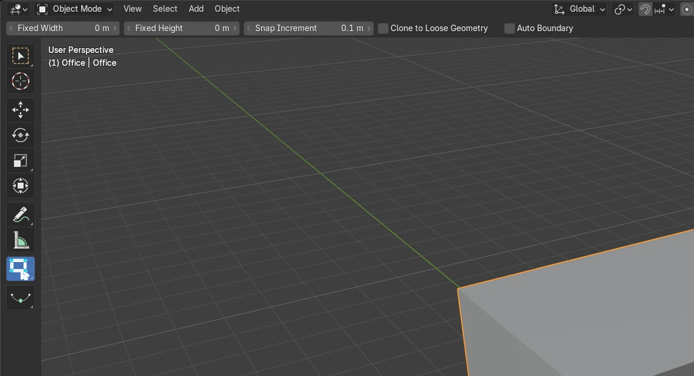

### 5. Separate Faces

OpenStudio needs one object per surface. Select the box, open **Modeling** and click **Separate Faces**. Every face becomes its own
object (`Office`, `Office 1`, ...) with `surfaceType` (Wall, Floor, RoofCeiling) set from its direction.

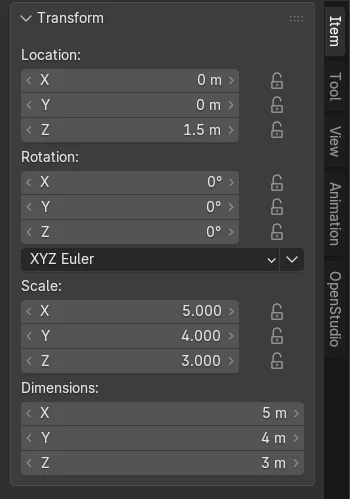{ width="350" }
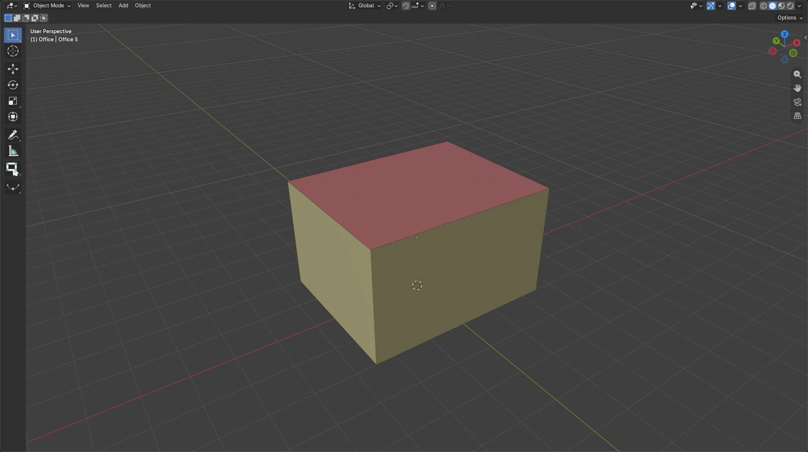

The colours come from the **Rendering** panel: click **Surface Type** to switch them on (see step 8). They only change how the model looks in the viewport.

### 6. Add a window

A window is a **sub surface**: you draw it as *loose geometry* and **project** it onto the wall behind. Loose geometry sits in the
collection `OpenStudio - Loose Geometry` and is never exported.

1. Pick the **Draw Rectangle Tool** and keep **Clone to Loose Geometry** and **Auto Boundary** ticked (the defaults).
2. Click two corners **on the wall**. The rectangle is drawn as loose geometry and projected at once: a window appears on the wall
   (a **Door** when the rectangle touches the bottom edge of the wall, a **Skylight** on a roof).
3. To do it by hand instead, untick **Auto Boundary**, draw (or select any mesh and click **Move to Loose Geometry** in **Modeling > Subsurface**),
   select the loose rectangle and click **Project Selected**. **Project All** projects everything in the loose collection.
4. Projecting again replaces the earlier result, so you can move the rectangle and project again.

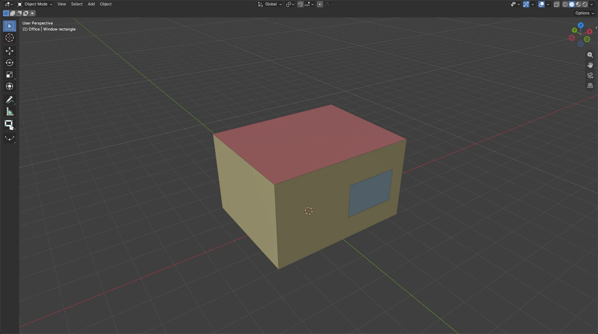

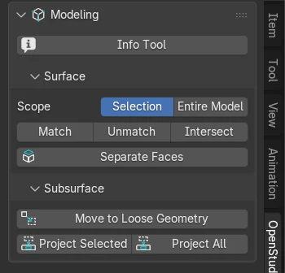{ width="350" }

!!! warning "The rectangle must lie on the wall"
    The loose face is projected onto surfaces in the same plane, within the operator's **Tolerance** (1 mm by default).
    A rectangle floating 5 cm in front of the wall is ignored (the message says "loose faces ignored") unless you raise **Tolerance** in the
    panel that opens at the bottom-left of the viewport after clicking **Project Selected**. The Draw Rectangle Tool snaps to the wall for you.

### 7. Assign properties

Click a wall. The **Properties** panel shows and edits the active object.

1. Under **Space** the name `Office` is the collection. The values below it (**Thermal Zone**, **Space Type**, **Building Story**, ...) belong to
   the *whole space*, so you set them once.
2. Click the **+** button next to **Thermal Zone**, type `Office Zone` and confirm. Use the drop-down in the field to pick names from the library later.
3. Pick a **Construction Set** the same way. Empty values mean "use the OpenStudio default".
4. Under **Boundary** the wall is `Outdoors`. Hold ++alt++ while changing a value to apply it to every selected surface.

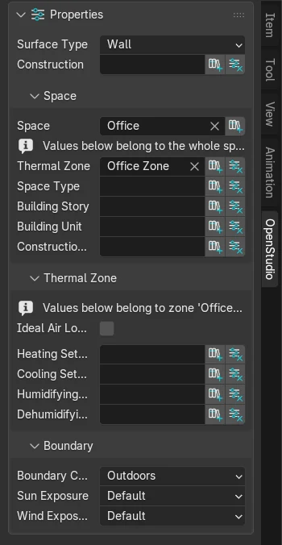{ width="350" }
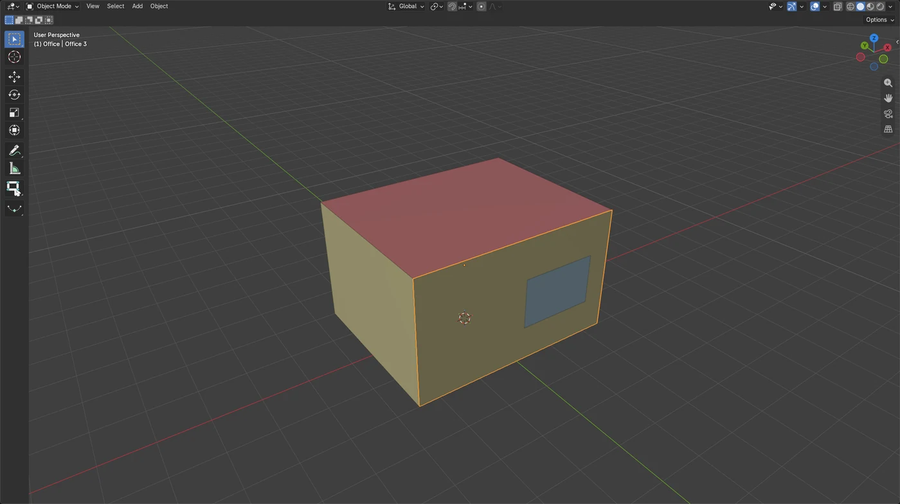

### 8. Check the model with colours

Open **Rendering** and click a mode: **Surface Type**, **Boundary Condition**, **Thermal Zone**, **Space Type**, **Building Story**,
**Construction**, **Normal**. **Off** returns to Blender's own colours. The **Colors** sub-panel is the legend.
These modes never change the exported data, they help you spot a wall typed as a roof or a boundary left unset.

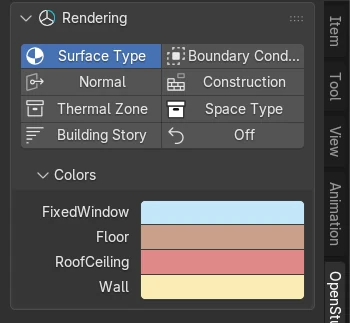{ width="350" }

| Surface Type | Boundary Condition | Thermal Zone |
| --- | --- | --- |
| 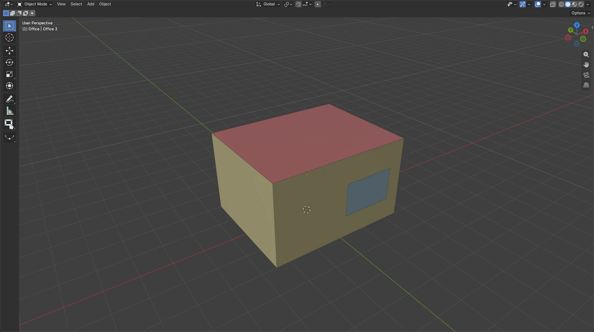 | 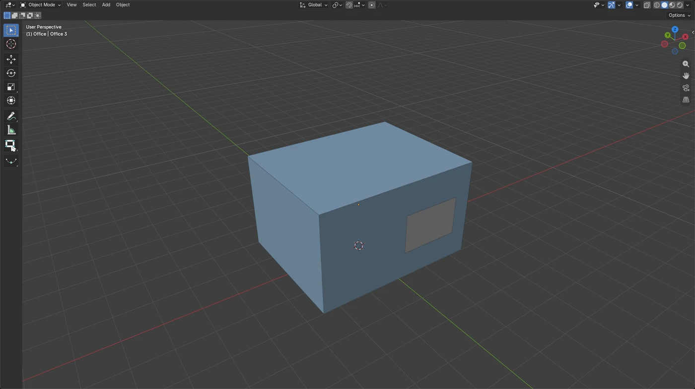 | 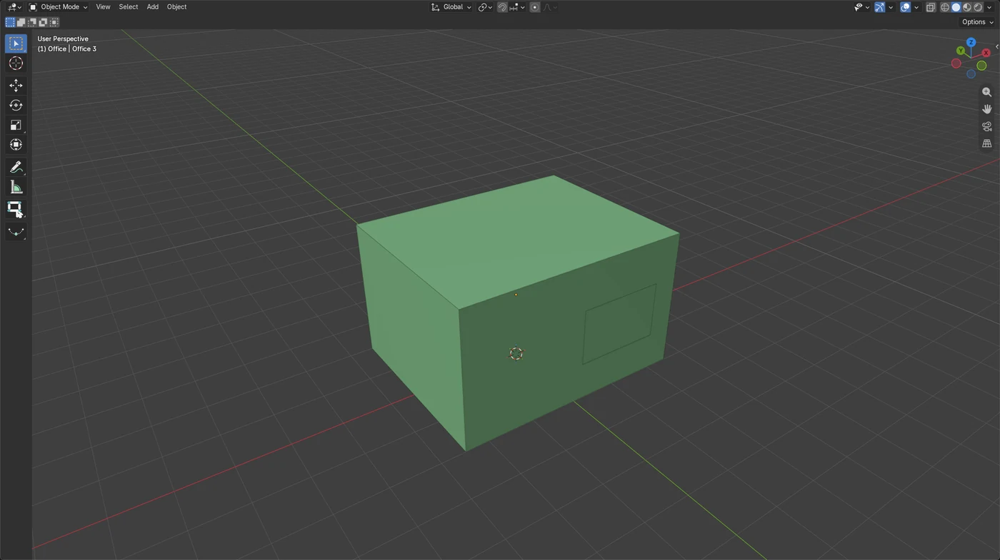 |

Use **Surface Search** to select, for example, all `Floor` surfaces, or all walls that face north.

### 9. Add a second space and match the walls

Rooms that touch share walls. EnergyPlus must know that two surfaces are the same wall seen from both rooms.

1. Create a new collection `Corridor` (step 3) and click it.
2. Add a box (step 4) with **Dimensions** `5`, `2`, `3` and **Location** X `0`, Y `3`, Z `1.5`, so it touches the office wall at `Y = 2`. Click **Separate Faces**.
3. In **Modeling > Surface** set **Scope** to *Entire Model* and click **Match**.

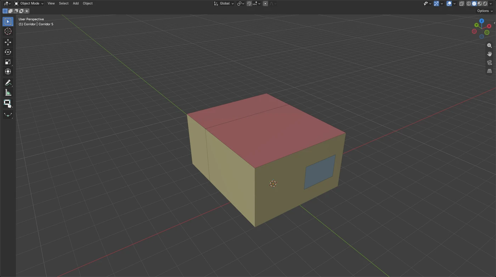

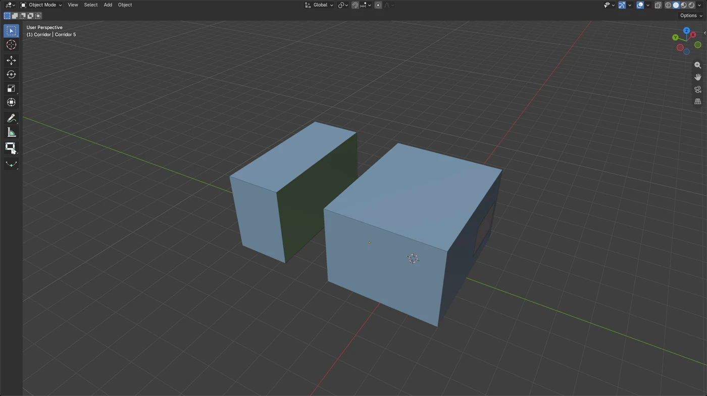

The shared wall now has the boundary condition `Surface` in both spaces and points to its partner. Walls that only partly overlap are
split so that the shared part is matched. **Unmatch** undoes it. Surfaces of the *same* space are never matched with each other.

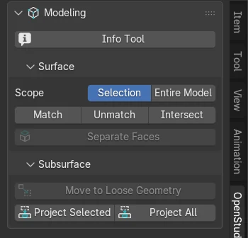{ width="350" }
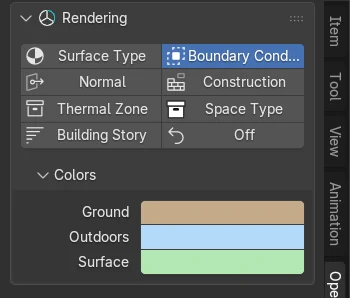{ width="350" }

### 10. Export

Open the **Scene** tab in the Properties editor (the cone and sphere icon), unfold **OpenStudio** and click **Export .osm**,
or use *File > Export > OpenStudio Model (.osm)*. The arrow next to the button offers gbXML, IDF, SDD and glTF.

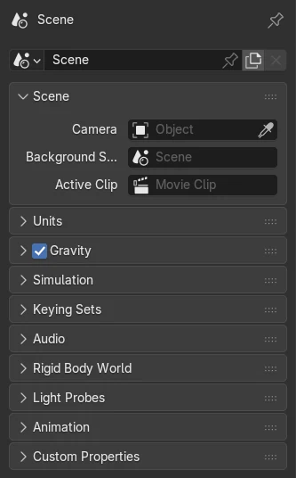{ width="340" }

Open the file in the OpenStudio Application (the **Tools** sub-panel has **Open in OpenStudioApplication**), or run it with the OpenStudio CLI.
If anything looks wrong, **Tools > Show Errors and Warnings** lists what the export repaired or skipped.

!!! tip "If something does not work"
    - **No OpenStudio tab**: hover the viewport and press ++n++; check that the extension is enabled in *Preferences > Add-ons*.
    - **A wall stays `Outdoors` although it touches a room**: both rooms must be in different collections and share the same plane. Run **Match** again after moving a space.
    - **A window is missing**: the loose rectangle was not on the wall (see the warning in step 6).
    - **Pressing a key does nothing**: the pointer is over another area (Outliner, Properties editor).

## Next steps

- [Interface guide](interface-guide.md): every panel in detail.
- [Cheat sheet](cheat-sheet.md): shortcuts on one page.
- [User scripts](user-scripts.md): the Scripts panel and all 39 ported scripts (building shapes, window-to-wall ratio, overhangs, ...).
- [Dev](dev/setup.md): build, test and extend the add-on.
