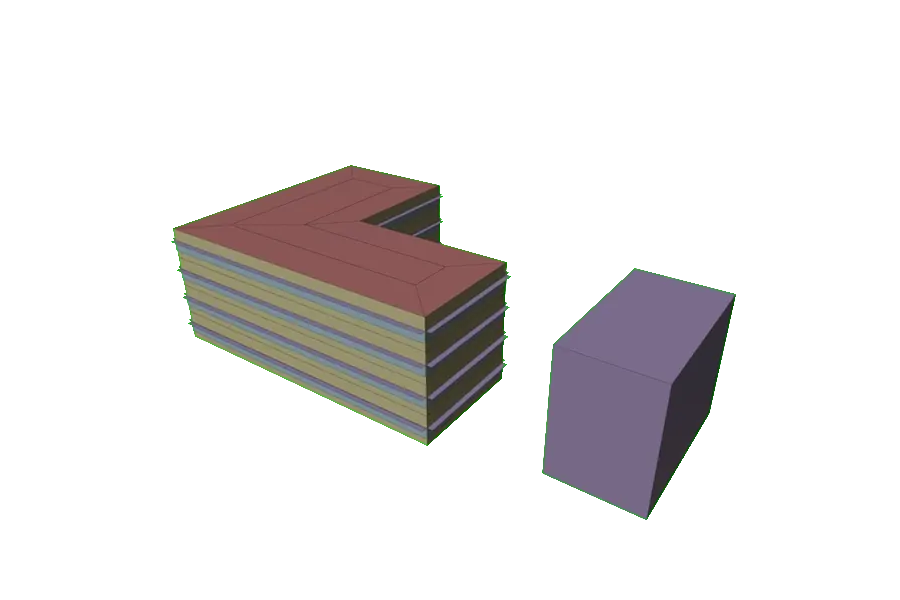
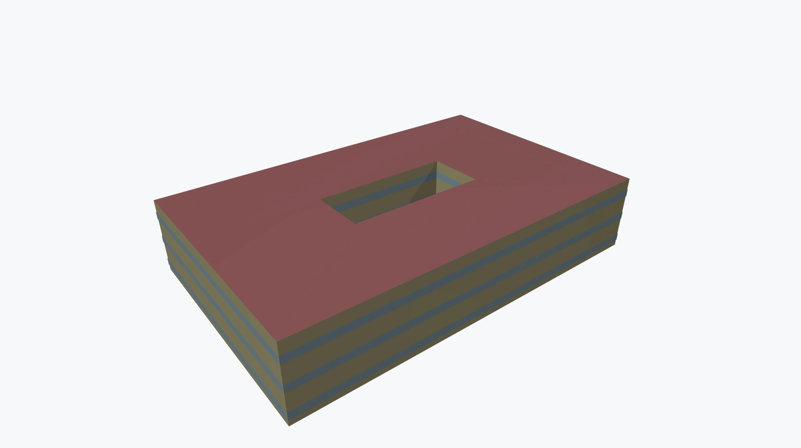
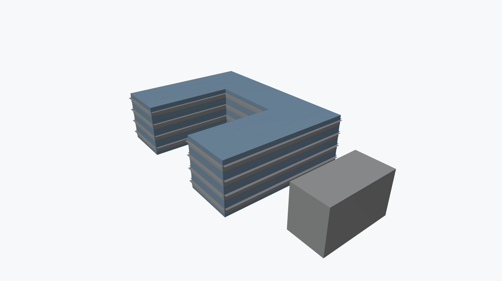
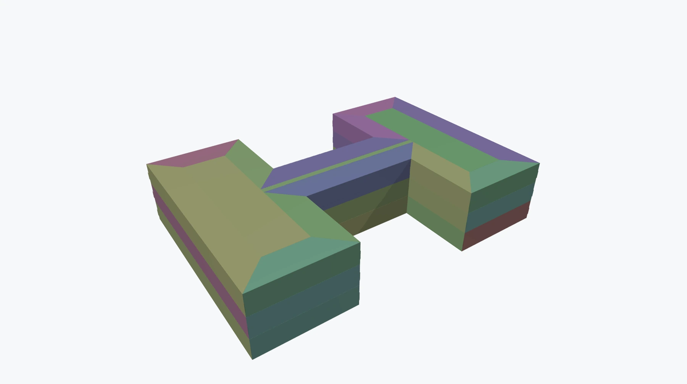
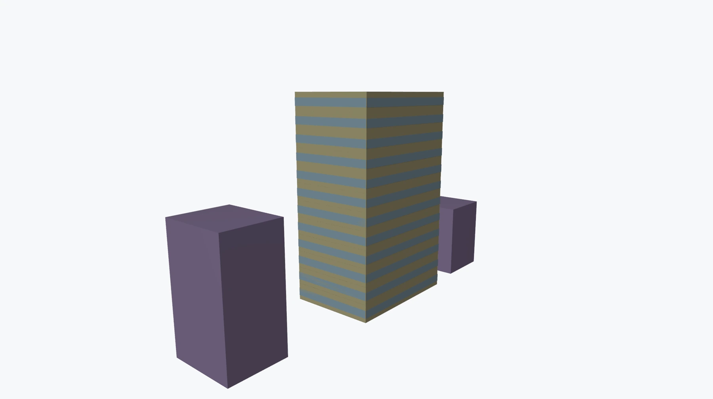
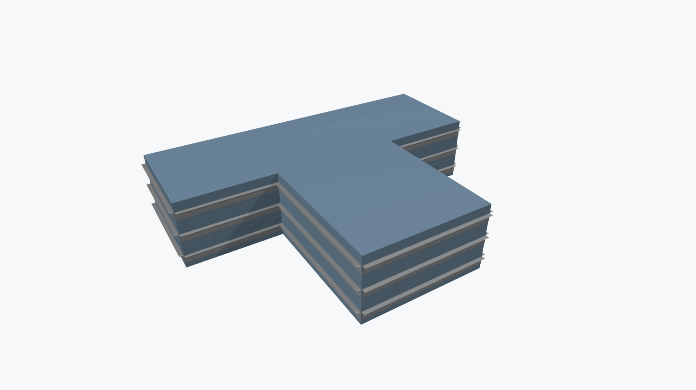
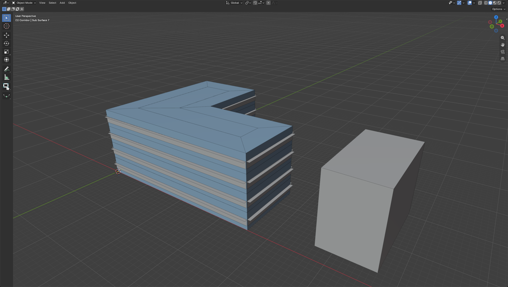

---
hide:
  - navigation
  - toc
---

Beta &middot; in testing

# Model buildings in Blender. Simulate in OpenStudio.

Draw spaces, windows and shading surfaces with Blender's tools, describe them with OpenStudio
properties and export a ready-to-run `.osm` (or gbXML) in one click.

[Get started](get-started.md){ .md-button .md-button--primary }
[Usage guide](interface-guide.md){ .md-button }

## What you get

-   :lucide-pencil-ruler:{ .lg .middle } **Draw surfaces**

    ---

    Draw Surface and Draw Rectangle tools with snapping, automatic face separation and loose geometry for windows.

-   :lucide-layers:{ .lg .middle } **Spaces are collections**

    ---

    A collection is a space. Zones, stories, space types and construction sets come from a template and name library.

-   :lucide-link:{ .lg .middle } **Surface matching**

    ---

    Adjacent surfaces of different spaces are matched and linked automatically, splitting partial overlaps.

-   :lucide-search:{ .lg .middle } **Search and inspect**

    ---

    Select surfaces by type, orientation, construction or boundary condition and edit every OpenStudio field.

-   :lucide-chart-no-axes-combined:{ .lg .middle } **Show results**

    ---

    Animate EnergyPlus results from the `.sql` file as heatmaps and value labels in the viewport.

-   :lucide-file-output:{ .lg .middle } **Export anywhere**

    ---

    `.osm` and gbXML export, plus import of both formats back into Blender.

## How it works

-   **Model in Blender**

    ---

    Every collection is a **space**, every face a **surface**. Draw, extrude or import geometry with the tools you already know.

-   **Describe with OpenStudio**

    ---

    Pick space types, zones, stories and constructions from a template, or set any OpenStudio field in the Inspector.

-   **Check it visually**

    ---

    Colour the model by surface type, boundary condition, zone or construction and search for what looks wrong.

-   **Export and simulate**

    ---

    One click writes the `.osm` that OpenStudio and EnergyPlus run. Results come back as heatmaps in the viewport.

## See it in action

A complete model in 40 seconds: a space, a window, a second space, matching and export.
New to Blender? The [Get started](get-started.md) page walks through every click.

<video class="osm-video" autoplay loop muted playsinline controls preload="metadata" src="img/walkthrough.mp4"></video>

## Showcase

Every building below was made inside Blender with Zonal: standard floor-plan scripts for the shape, then
Match Surfaces, window-to-wall ratio, overhangs and site shading. Colours show the render modes.

-   

    **Courtyard**, 3 storeys, coloured by *surface type* (roof, wall, window).

-   

    **U-shape with a neighbour**, 4 storeys, window overhangs, site shading block, coloured by *boundary condition*.

-   

    **H-shape**, 3 storeys, coloured by *thermal zone*: perimeter and core zones are generated per floor.

-   

    **Tower in context**, 12 storeys, 45 % window-to-wall ratio, shading from neighbouring buildings.

-   

    **T-shape**, 3 storeys with overhangs by projection factor.

-   

    **L-shape**, 4 storeys, the model used throughout the [Usage guide](interface-guide.md).

## Formats

| Direction | Format | File type |
| --- | --- | --- |
| Export | OpenStudio Model | `.osm` |
| Export | gbXML | `.xml` |
| Export | Standard Data Dictionary (SDD) | `.xml` |
| Export | EnergyPlus Input Data File (IDF) | `.idf` |
| Export | glTF (binary or separate files) | `.glb`, `.gltf` |
| Import | OpenStudio Model, gbXML, glTF | `.osm`, `.xml`, `.glb`, `.gltf` |
| Results | EnergyPlus SQLite output, displayed as heatmaps and value labels in the viewport | `.sql` |

Imported models are rebuilt as Blender spaces (collections) and surfaces (mesh objects).
Templates in `.osm` or `.idf` format provide space types, construction sets and schedules as defaults for a new model.

## Where to go next

-   :lucide-rocket:{ .lg .middle } **[Get started](get-started.md)**

    ---

    Ten illustrated steps, with SketchUp-to-Blender translation tables for first-time Blender users.

-   :lucide-book-open:{ .lg .middle } **[Usage guide](interface-guide.md)**

    ---

    Every panel and tool explained with screenshots.

-   :lucide-keyboard:{ .lg .middle } **[Cheat sheet](cheat-sheet.md)**

    ---

    Shortcuts and the habits that differ from SketchUp, on one page.

-   :lucide-scroll-text:{ .lg .middle } **[User scripts](user-scripts.md)**

    ---

    39 ready-made scripts: building shapes, window ratios, overhangs, reports and the template wizard.

