# Interface Guide

This page is the legend for everything the add-on adds to Blender.

Most panels live in the 3D viewport sidebar (press **N**), in the **OpenStudio** tab. Import / export and the
north axis are in the **Properties editor > Scene > OpenStudio** panel. New to Blender? Start with [Get started](get-started.md).
The demo model used in the screenshots is a four-storey L-shaped building made with the Scripts panel (window-to-wall ratio,
overhangs, thermal zones) plus a neighbouring block as site shading, with the default template loaded.

## Concepts

| OpenStudio | Blender |
| --- | --- |
| Space | A **collection** (its name is the default `spaceName`) |
| Surface / SubSurface / Shading surface | A single-face **mesh object** with a `surfaceType` custom property |
| Properties of a surface | Object custom properties, edited through the `osm_<key>` proxies |
| Space attributes (space type, thermal zone, story, building unit, construction set) | Stored once per **Space** (Inspector store), never per surface |
| Thermal zone, story, space type, construction set, ... | The name library (Template & Library) and the Inspector store |
| Drawing aids | Meshes in the collection `OpenStudio - Loose Geometry` (never exported) |

## File Management

| Panel | Functionality |
| --- | --- |
| 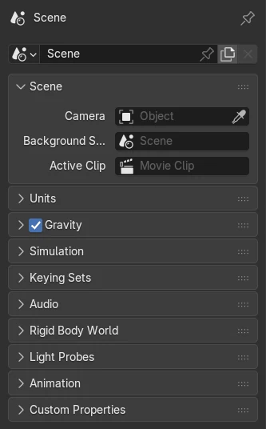 | <h4>Properties editor > Scene > OpenStudio</h4>**Export .osm** reads the evaluated scene directly (no intermediate glTF file) and builds the model with the OpenStudio API; **Import .osm** reads an `.osm` back. The arrow next to each button opens a menu with the other formats: gbXML, EnergyPlus IDF, SDD and OpenStudio glTF, all converted through the OpenStudio model (also in *File > Export / Import*). **Building North Axis (deg)** is the scene custom property `northAxis`; click **+ North Axis** to add it. The status line shows the OpenStudio version in use (or why the bindings could not be loaded). The collapsed **Tools** sub-panel has **Open in OpenStudioApplication** and **Show Errors and Warnings** (lists the last export / import warnings and writes the text `OpenStudio Report`). |
| 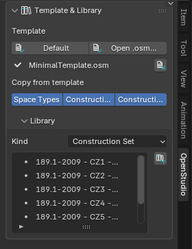 | <h4>Template & Library</h4>*Template*: **Default** loads the bundled `MinimalTemplate.osm`; **Open .osm…** loads your own or merges further `.osm` / `.idf` files (the category buttons under *Copy from template* choose what is merged: space types, construction sets, constructions, schedules). Imported files are listed with an **X** to remove them. The template's space types, construction sets and constructions are added to the name library and copied into the exported model (its spaces, zones and stories are stripped). The **Library** sub-panel has a **Kind** dropdown (Thermal Zones, Space Types, Building Stories, Building Units, Constructions, Construction Sets) over one list of names; **+** creates a name, **-** removes the selected one from the library. The name fields in the Properties panel use this library for their drop-downs. |

## Modeling Tools

| Panel | Functionality |
| --- | --- |
| 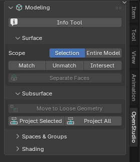 | <h4>Modeling</h4>Top level: the **Info Tool** button; the tools are in the sub-panels below. |
|  | <h4>Draw Rectangle Tool</h4>In the viewport toolbar; settings in the tool header: **Fixed Width / Fixed Height** (0 = set by dragging; with both set a click places the rectangle), **Snap Increment** (hold **Ctrl** to snap to that grid; points otherwise snap to vertices, edge midpoints and edges), **Clone to Loose Geometry** (create a drawing aid instead of a surface) and **Auto Boundary**, both on by default so that the tool draws windows (untick them to draw real surfaces) (project the rectangle onto the surface it lies on, creating a sub surface). |
| | <h4>Surface sub-panel</h4>**Scope** (Selected / All) for **Match**, **Unmatch** and **Intersect**. Match sets the boundary condition `Surface` on facing surfaces of *different* spaces and links them through `outsideBoundaryConditionObjectName`; partly overlapping surfaces are split so the shared part is matched. Unmatch clears it. Intersect cuts a surface where another passes completely through it. **Separate Faces** replaces each selected multi-face mesh by one object per face (`name`, `name.001`, ...) and sets `surfaceType` from the face normal. |
| | <h4>Subsurface sub-panel</h4>**Move to Loose Geometry** moves the selected objects to the `OpenStudio - Loose Geometry` collection. **Project Selected / Project All** project their faces onto the coplanar surfaces of the model and create sub surfaces (windows, doors, ...) in every space they touch. Re-running replaces earlier projections. |
| | <h4>Spaces & Groups sub-panel</h4>**Create Spaces From Diagram**, **Create Spaces From Mesh** (finds the enclosed volumes of a mesh, one collection per cell), **Set Attributes for Selected Spaces** and **Zone per Space**. |
| | <h4>Shading sub-panel</h4>**Site / Building / Space** turn the selected objects into shading surfaces of that group; **Set as Interior Partition** makes them interior partition surfaces. |
| | <h4>Info Tool</h4>Modal tool: hover a surface to see its OpenStudio properties in an overlay; **Esc** / right click ends it. |

## Properties

| Panel | Functionality |
| --- | --- |
| 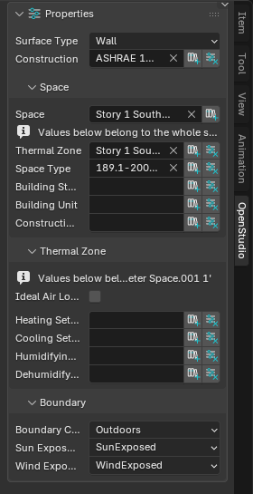 | <h4>Properties</h4>For the active mesh (the same fields are in *Properties editor > Object > OpenStudio*): surface type, parent surface (sub surfaces) and construction. Sub-panels: **Space** (space name and, for the whole space, thermal zone, space type, story, building unit, construction set), **Thermal Zone** (ideal air loads and the four setpoint schedules of the object's zone) and **Boundary** (boundary condition plus adjacent surface when it is `Surface`, sun and wind exposure). Space and zone values belong to the space / zone, so editing them on one surface changes all of them; **Alt**+click applies a value to every selected object. Empty / *Default* means "use the OpenStudio default". |

## Search and Inspector

| Panel | Functionality |
| --- | --- |
| 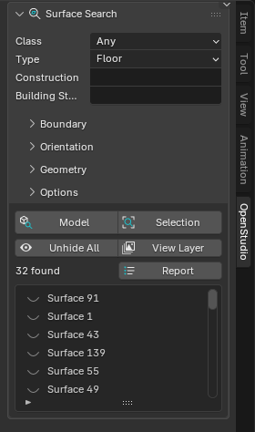 | <h4>Surface Search</h4>Top: class, type, construction and building story. Sub-panels: **Boundary** (boundary condition, sun, wind), **Orientation** (azimuth range clockwise from the north axis with wrap-around, tilt range, exclude horizontal), **Geometry** (non-convex only, more than N vertices) and **Options** (invert, invert across classes, hide everything else). The last section has **Model** / **Selection** search buttons (results are selected in the viewport), **Unhide All**, **View Layer** (a view layer showing only the results) and a result count with **Report** and a clickable hit list. |
| 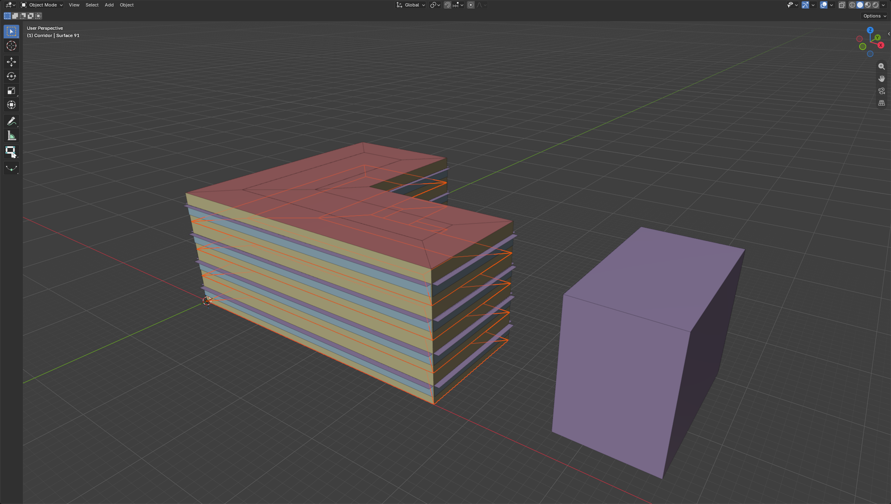 | Result of the search in the previous row (`Type = Floor`): the matching objects are selected in the viewport. |
| 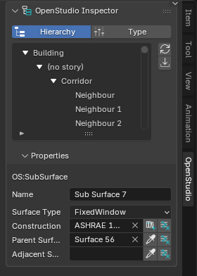 | <h4>OpenStudio Inspector</h4>Choose how to pick an object with the **picker** buttons: **Hierarchy** (a collapsible model tree, with refresh and **Move Values to Spaces** buttons that migrate old per-surface space values to the spaces) or a **type** dropdown plus an **object** dropdown (**+** / **-** create or remove objects of that type). The **Properties** sub-panel edits the fields. Surface, SubSurface, ShadingSurface and InteriorPartitionSurface edit the object's custom properties; the other types are stored in the scene (`osmModel`) and written into the `.osm` on export, and store values win over per-surface properties. Schedule rules (`ScheduleConstant`) have a rule list and a calendar of dates. |
| 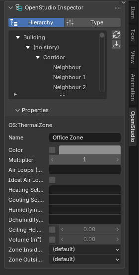 | The store-backed types: Building, Space, ThermalZone, BuildingStory, BuildingUnit, SpaceType, Weather File (an `.epw` picker with reset buttons), Default Construction / Schedule Sets and Default (Sub)Surface Constructions. *Not yet covered:* Facility, Daylighting:Control, Glare:Sensor, IlluminanceMap, ShadingControl, FrameAndDivider. |

## Rendering

| Mode | Functionality |
| --- | --- |
| 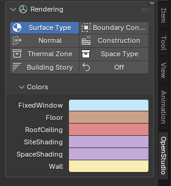 | <h4>Rendering</h4>One button per mode: **Surface Type**, **Boundary Condition**, **Normal**, **Construction**, **Thermal Zone**, **Space Type**, **Building Story** and **Off** (back to Blender's material colours). The **Colors** sub-panel shows the legend of the active mode with editable swatches and **Reset Colors**. |
|  | Mode *Surface Type*: walls, floors, roofs, windows, doors and shading surfaces. |
| 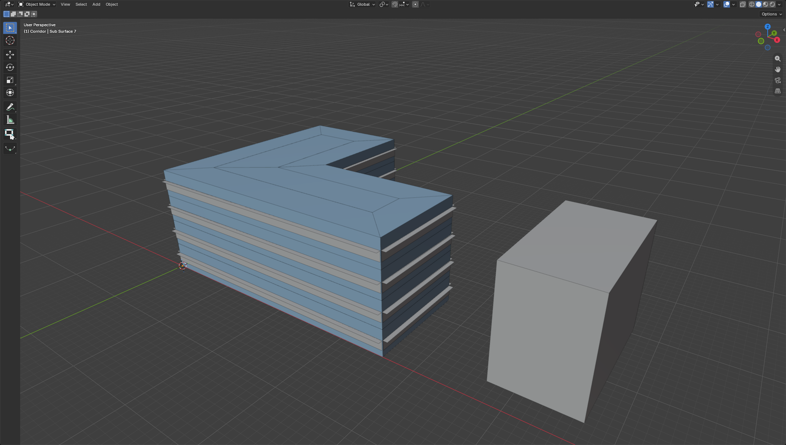 | Mode *Boundary Condition*: Outdoors, Ground, Surface, Adiabatic, Foundation. Unset values are grey. |

The modes (also in the viewport shading popover, under **OpenStudio**, and in the pie menu **Ctrl+Shift+O**) write *Object > Viewport Display > Color* and switch the viewport colour type to **Object**; they never touch the exported data. The pie menu also has Draw Rectangle, Separate Faces, Match Selection, Info Tool and Set Attributes. With *Auto-Update Render Mode* (preferences) the colours follow your edits.

## Results

| Panel | Functionality |
| --- | --- |
| 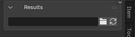 | <h4>Results</h4>Pick an EnergyPlus `eplusout.sql` and load it. Then choose environment and frequency, a variable from the list, an optional key filter and *Only Selected*, and press **Apply** (keyframes a value on every surface by object name, or zone by thermal zone, space or collection) or **Clear**. Sub-panels: **Heatmap** (checkbox in the header, manual range, presets and colour ramp), **Labels** (Geometry Nodes text: decimals, size, upright, offset) and **Animation** (start frame, frames per step, stride, interpolation, set frame range), so it animates and renders. |

## Scripts

| Panel | Functionality |
| --- | --- |
| 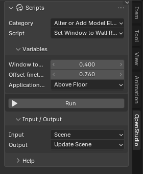 | <h4>Scripts</h4>Pick a **Category** and, when it has several, a **Script**. Sub-panels: **Variables** (the script's arguments; refresh button when they depend on the model), **Input / Output** (scene or `.osm` file in; replace the scene or save an `.osm` out) and **Help**. **Run** executes it. Ports of the SketchUp plug-in user scripts, see [User scripts](user-scripts.md). |

## Preferences

*Edit > Preferences > Add-ons > OpenStudio*: OpenStudio install path and OpenStudio Application path, show warnings after export / import (and how many appear in the status bar), new thermal zone per new space, auto-update render mode, unit system (SI / IP), disable scripts, and tolerances for snapping, sub surface offset and geometry repair (out-of-plane, sub surface plane distance / parallel limit).
